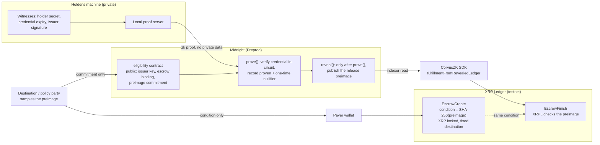

# CorvusZK

[](https://github.com/CorvusZK-1/CorvusZK/actions/workflows/ci.yml)
[](LICENSE)


**Prove a private fact on Midnight, then release a native XRPL escrow.** CorvusZK is an open-source TypeScript SDK plus four Compact contracts that let an XRPL app hold payment in a standard XRPL escrow until a zero-knowledge check passes on Midnight: "this holder has a valid credential", "age over N", "balance above X", or "condition met". The private inputs never leave the holder's machine. CorvusZK never holds funds or keys.

*Built on [Midnight](https://midnight.network) (Compact, Midnight.js, proof server) and the [XRP Ledger](https://xrpl.org). Midnight Buildathon Wave 3 entry.* Testnet only (Midnight Preprod + XRPL testnet). Unaudited. Not affiliated with the Midnight Foundation, Ripple, or the XRPL Foundation.

## Judge quick-start (5 minutes)

1. **See it run (1 min, nothing to install).** [corvuszk.com/demo](https://corvuszk.com/demo/) steps through the live run of 12 Nov 2026 (ledger 9): XRPL escrow locked → eligibility contract deployed on Midnight Preprod → private `prove` → `reveal` → XRPL escrow released. Every step links to the public explorer. A [72-second video](https://corvuszk.com/) is on the homepage. The demo page is a replay of that recorded run, not a live wallet connection.
2. **Run the contracts locally (3 min, Node 22.18+ or 24, no wallet, no tokens).**
   ```bash
   git clone https://github.com/CorvusZK-1/CorvusZK && cd CorvusZK
   npm ci && (cd midnight && npm ci)
   npm run test:offline         # SDK units + eligibility circuit + simulator tests for all 4 contracts
   npm run simulate             # runs the compiled Compact circuits: pass and refuse cases
   npm run example:eligibility  # mock credential → prove → refusal before reveal → fulfillment from revealed state
   ```
3. **Recompile the contracts (1 min).** With the [Compact toolchain](https://docs.midnight.network/) installed: `compact update 0.36.0 && npm run compile:check`. It compiles all four contracts and checks the output matches the committed `midnight/managed/` artifacts byte for byte. [CI](https://github.com/CorvusZK-1/CorvusZK/actions/workflows/ci.yml) does the same on every push.
4. **Check the chain evidence.** The [deployed contracts table](#deployed-contracts) links every address and proof transaction.
5. **Read the limits.** [Security model](#security-model): what XRPL does and does not enforce, and who must be trusted.

### Where things are

| Path | What it is |
|---|---|
| [`contracts/`](contracts/) | The four Compact contracts: `eligibility`, `condition`, `age_over`, `balance_above` |
| [`midnight/witnesses.ts`](midnight/witnesses.ts) | Typed witness implementations (private inputs) for all four contracts, checked against the compiler's generated types |
| [`midnight/managed/`](midnight/managed/) | Compiler output: TypeScript contract API, ZKIR circuits, proving and verifying keys |
| [`midnight/eligibility.mjs`](midnight/eligibility.mjs) | Mock issuer, Schnorr credential, XRPL preimage binding, `fulfillmentFromRevealedLedger` |
| [`midnight/sdk-bridge.mjs`](midnight/sdk-bridge.mjs), [`providers.mjs`](midnight/providers.mjs), [`wallet9.mjs`](midnight/wallet9.mjs) | Midnight.js provider stack: wallet, proof server, indexer, deploy, `callTx`, ledger reads |
| [`midnight/live-eligibility.mjs`](midnight/live-eligibility.mjs) | The end-to-end script behind the 12 Nov run (`npm run live:eligibility`) |
| [`src/`](src/) | The TypeScript SDK (`MidnightBackend`, `LocalSimulationBackend`, XRPL escrow helpers) |
| [`test/`](test/) | `templates.test.mjs` (contract simulator tests), `eligibility.test.mjs`, `unit.test.mjs`, `xrpl.integration.test.mjs` (live XRPL testnet) |
| [`docs/demo/`](docs/demo/) | The corvuszk.com/demo page |

## Deployed contracts

All on **Midnight Preprod, ledger 9** (testnet, free test tokens). Machine-readable copy: [`midnight/deployments.preprod.json`](midnight/deployments.preprod.json). Receipts: [11 Nov](receipts/ledger9-preprod-2026-11-11.md), [12 Nov](receipts/ledger9-preprod-2026-11-12.md).

| Network | Contract | Address | Proof transaction | Date (PT) |
|---|---|---|---|---|
| Preprod | `eligibility` (one instance per escrow; this is the 12 Nov run's instance) | [`b8a7935e586c31800fc0b424c4f7e83d274c62d8dab3b63b77708d569ba0c1f2`](https://preprod.midnightexplorer.com/contracts/b8a7935e586c31800fc0b424c4f7e83d274c62d8dab3b63b77708d569ba0c1f2) | [`prove`](https://preprod.midnightexplorer.com/transactions/88a89d1df54979f400b991cf4b7e152dccacd18950cef3539af7d7f1611a3859) · [`reveal`](https://preprod.midnightexplorer.com/transactions/0cb52d18a22d6c2dccc588f7668c732efa96eb18316e4425363a71a7e382d586) | 12 Nov 2026 |
| Preprod | `age_over` | [`838bb8f23e4413da672fdae86d29c7918da2dab8ab6e32ff9c824357127ea16f`](https://preprod.midnightexplorer.com/contracts/838bb8f23e4413da672fdae86d29c7918da2dab8ab6e32ff9c824357127ea16f) | [`prove` (11 Nov)](https://preprod.midnightexplorer.com/transactions/fb86e2539597ce7934c10cfc528ea890c4ed2513af25756e2b27218ba59ada89) · [`prove` (12 Nov)](https://preprod.midnightexplorer.com/transactions/cdd140eefcb38622f05de9091fd75d39331ff1143d46893aa61bfdaa91b9e455) | 11 Nov 2026 |
| Preprod | `balance_above` | [`7eab336024024dfec2787023d0ee5af56818d9199425bb76f1b756570f04284b`](https://preprod.midnightexplorer.com/contracts/7eab336024024dfec2787023d0ee5af56818d9199425bb76f1b756570f04284b) | [`prove`](https://preprod.midnightexplorer.com/transactions/e14168707c2f48a3edd0a5f7bdaaa0aef1cf51c13da456763da1f22b28fabd4f) | 11 Nov 2026 |
| Preprod | `condition` | [`b6f78efb34e84b8809267764f0f62eaab5f375c845cc57a64a63b700dde04df3`](https://preprod.midnightexplorer.com/contracts/b6f78efb34e84b8809267764f0f62eaab5f375c845cc57a64a63b700dde04df3) | [`attest`](https://preprod.midnightexplorer.com/transactions/c974a56ea2e257d09701d55c9d82cc6a9dcb7231d565a6324dd0c5b6e343847f) | 11 Nov 2026 |
| **Mainnet** | all four | **Deploying — not live yet.** No mainnet address exists yet. This row will only be filled in after the deploy transactions confirm. | — | — |

XRPL testnet side of the 12 Nov run: [`EscrowCreate`](https://testnet.xrpl.org/transactions/593F1F56ED7AD8FB7C4C4DF7D78EF2DE41AC3DE085DC476BC30B348F350FAB41) (20 test XRP) and [`EscrowFinish`](https://testnet.xrpl.org/transactions/194F5D8FD89AFF3E95ACC7A140D2ED2AB6129EA7E6A73A2C7A2A0BAE6634354C) (`tesSUCCESS`), about 88 seconds apart. Older ledger 8 records (3–6 Nov 2026) are kept under `ledger8History` in the deployments file and in [docs/live-run.md](docs/live-run.md).

## Architecture



The payer never receives the preimage, so the payer cannot release early. XRPL does not read Midnight: the link is the crypto-condition. The destination, who sampled the preimage, could finish without Midnight and must be trusted not to. Details: [Security model](#security-model).

### Private vs public state (Midnight's two ledgers)

Midnight splits each contract into private state, kept on the user's machine and fed to circuits as witnesses, and public ledger state on chain. Only values a circuit explicitly `disclose()`s become public.

| Contract | Private (witness, stays on the holder's machine) | Public (on the Midnight ledger) |
|---|---|---|
| `eligibility` | holder secret, credential expiry, issuer Schnorr signature (nonce point, scalar), release preimage until `reveal` | issuer public key, credential type, as-of date, XRPL owner / sequence / destination, preimage commitment, `proven`, nullifier, preimage after `reveal` |
| `age_over` | birth year, salt | minimum age, as-of year, birth-year commitment, `proven` |
| `balance_above` | balance, salt | threshold, balance commitment, `proven` |
| `condition` | attester secret, "delivered" flag | attester commitment, escrow id, `released` |
| XRPL escrow | — | amount, payer, destination, condition, finish time (XRPL fields are always public) |

## Status (honest)

| Part | State |
|---|---|
| Compact contracts (4) | Compile with Compact 0.36.0 (language 0.28.0, compact-runtime 0.21.0, ledger 9). CI recompiles them and checks the committed artifacts match. |
| Eligibility + XRPL escrow release | **Ran live on Preprod ledger 9 on 12 Nov 2026** (receipts above). First ran on ledger 8 on 6 Nov 2026. The issuer is a labeled **mock**, not a regulated KYC provider and not an XRPL Credential (XLS-70) object. |
| `condition`, `age_over`, `balance_above` | Deployed on Preprod ledger 9 on 11 Nov 2026, one proof call each (indexer status SUCCESS). `age_over` proved again on 12 Nov. |
| Tests | Offline suites (SDK units, eligibility circuit, simulator tests for all four contracts) run in CI. The live XRPL testnet escrow test runs as a separate best-effort CI job because it depends on the public faucet. CI does not run live Midnight transactions (that needs a funded wallet and a proof server). |
| `MidnightBackend` (SDK) | Runs the compiled circuits locally (`local-circuits`), attaches Preprod addresses (`preprod`), posts a Preprod `callTx` (`submitOnChain`), and deploys / calls / reads eligibility instances. |
| `LocalSimulationBackend` | Ed25519-signed attestation for learning the API offline. **Not zero-knowledge.** |
| Midnight mainnet | **Not live.** Deploy in progress; no mainnet addresses yet. |
| Frontend | [corvuszk.com/demo](https://corvuszk.com/demo/) replays the 12 Nov run with explorer links and live XRPL lookups. A wallet-connected live page is not built yet. |
| Users / revenue | None yet. |

## Security model

Short version. The full write-up, with tables for each check and replay case, is in [docs/security-model.md](docs/security-model.md).

- **How the chains connect.** The XRPL escrow condition is SHA-256 of a 32-byte preimage. The eligibility contract stores a commitment to that preimage (not the preimage), plus the escrow's owner, sequence and destination. `prove()` checks the mock issuer's Schnorr signature in-circuit and records a one-time nullifier bound to that escrow. `reveal()` only works after `prove()` and only for the committed preimage. The SDK then rebuilds the XRPL fulfillment from the revealed ledger state.
- **What XRPL enforces.** Only the crypto-condition and the fixed destination. XRPL does not verify the Midnight proof. The party who sampled the preimage (the destination, in the default mode) can finish without Midnight and must be trusted not to. The payer never sees the preimage and cannot finish early.
- **Replay.** A second `prove()` or `reveal()` on the same contract fails. The nullifier changes with owner, sequence, destination or preimage commitment. There is no cross-contract nullifier registry.
- **Privacy limits.** XRPL amount, accounts and timing stay public. After `reveal()`, the preimage is public.
- **Other limits.** Mock issuer only. 96-bit demo scalars. Unaudited. Testnet only.

## Who it is for

TypeScript builders shipping small XRPL apps that need a private yes/no before releasing escrowed XRP: age-gated goods, proof-of-funds style checks, "condition met" attestations, without becoming a custodial wallet. Why Midnight: XRPL has native escrow but no private programmable checks; Midnight's Compact contracts add those without moving the money off XRPL. Comparisons with XRPL Credentials, Xahau Hooks, Boundless Smart Escrows and other Midnight projects, plus fee notes, are in [docs/alternatives-and-costs.md](docs/alternatives-and-costs.md).

Docs: [getting started](docs/getting-started.md) · [what's included](WHAT-YOU-GET.md) · [the proof templates](docs/templates.md) · [XRPL escrow flow](docs/xrpl-escrow-flow.md) · [live eligibility run how-to](docs/live-eligibility.md) · [on-chain submit](docs/on-chain-submit.md) · [proof server](docs/proof-server.md) · [SECURITY.md](SECURITY.md) · [CHANGELOG](CHANGELOG.md)

## Use it in your app

Requires Node 20+ for the SDK (Node 22.12+ for the `midnight/` runtime, Node 24 in CI).

```bash
npm install && npm run build
npm run demo:offline        # no network: the 3 claims, passing and refused cases
npm run example:offline     # same idea as a copy-pasteable examples/ script
npm test                    # all tests, including 1 live XRPL testnet escrow test
npm run demo                # local web demo at http://localhost:8787 using free XRPL testnet faucet wallets
```

### Which backend to use
| Backend | What it is | Use when |
|---|---|---|
| `LocalSimulationBackend` | Ed25519-signed attestation. **Not ZK.** | Learning the escrow API offline / in unit tests |
| `MidnightBackend` | Real Compact circuits via `midnight/sdk-bridge.mjs`; `submitOnChain` for Preprod callTx | Circuit prove/verify locally, or post a new on-chain attest/prove when wallet + proof server + DUST are ready |

Use it in your app (simulation backend):
```ts
import * as xrpl from 'xrpl';
import { LocalSimulationBackend, createCryptoCondition, createEscrow, proveAgeOver, verifyAndReleaseEscrow, XRPL_TESTNET_WSS } from 'corvuszk';
const client = new xrpl.Client(XRPL_TESTNET_WSS); await client.connect();
const cond = createCryptoCondition();                       // payer keeps cond.fulfillment
const esc = await createEscrow(client, payer, { destination: payee.address, amountXrp: '20', condition: cond.condition });
const backend = new LocalSimulationBackend();
const proof = await proveAgeOver(backend, 1990, 18, 2026, salt);
await verifyAndReleaseEscrow(client, payee, { backend, proof, owner: esc.owner, offerSequence: esc.offerSequence, ...cond });
```

Real Compact circuits via `MidnightBackend` (local circuits; no redeploy):
```ts
import { MidnightBackend, proveAgeOver, proveBalanceAbove, proveCondition } from 'corvuszk';
// Token from env only — never hard-code or log it.
const backend = new MidnightBackend({
  blockfrostProjectId: process.env.BLOCKFROST_MIDNIGHT_PREPROD,
  mode: 'local-circuits', // or 'preprod' to attach deployments.preprod.json addresses
});
// Needs: cd midnight && npm ci  (Compact runtime + managed circuits)
const age = await proveAgeOver(backend, 1990, 18, 2026, 'dev-salt');
const bal = await proveBalanceAbove(backend, 5000, 1000, 'dev-salt');
const ok = await backend.verify(age); // true when the circuit accepted the witness

// Optional: post a new on-chain callTx (needs proof server + synced wallet with DUST)
// const { txHash, proof } = await backend.submitOnChain({
//   claim: age.claim,
//   witness: { kind: 'ageOver', birthYear: 1990, salt: 'dev-salt' },
//   syncTimeoutMs: 90_000,
// });
```

Docs for chain submit: [on-chain submit](docs/on-chain-submit.md) · [proof server runbook](docs/proof-server.md)

### API
- `proveCondition(backend, secret, salt, commitment)`, `proveBalanceAbove(backend, balance, threshold, salt)`, `proveAgeOver(backend, birthYear, minAge, asOfYear, salt)` return a `Proof`, or throw if the predicate is false. Helpers pass private witnesses into `MidnightBackend` without putting them on `Proof.claim`.
- `createCryptoCondition()` returns a PREIMAGE-SHA-256 `{condition, fulfillment}`.
- `createEscrow(client, payerWallet, {destination, amountXrp, condition, cancelAfterSec})`
- `verifyAndReleaseEscrow(client, submitter, {backend, proof, owner, offerSequence, condition, fulfillment})` verifies the proof first, then submits EscrowFinish.
- `commit(value, salt)` creates a hiding commitment. The simulation uses SHA-256; the Compact templates use `persistentHash`. `MidnightBackend` rewrites `Proof.claim.commitment` to the Compact commitment.
- `MidnightBackend.submitOnChain({ claim, witness, contractAddress?, syncTimeoutMs? })` submits a Preprod `callTx` and returns `{ txId, txHash, blockHeight, contractAddress, proof }`. Callers pass witnesses; the SDK persists nothing. Fails fast if Blockfrost, proof server, sync, or DUST are missing.

### To enable real Midnight Preprod proofs
1. Create a free Blockfrost account and a "Midnight Preprod" project. Its token starts with `nightpreprod`. Export it as `BLOCKFROST_MIDNIGHT_PREPROD` (never commit or log it).
2. `cd midnight && npm ci` so `MidnightBackend` can load `sdk-bridge.mjs` and the managed circuits.
3. For **local circuit proofs** (SDK default): nothing else — `new MidnightBackend({ blockfrostProjectId: process.env.BLOCKFROST_MIDNIGHT_PREPROD })` then `proveAgeOver` / etc.
4. For **on-chain submit** against contracts already in `midnight/deployments.preprod.json`: start the proof server (see [docs/proof-server.md](docs/proof-server.md)), ensure the deployer wallet has DUST, then `backend.submitOnChain(...)` or `cd midnight && node submit-onchain.mjs --template age_over`. For a **fresh deploy**, use `midnight/deploy.mjs` / `ensure-pipeline.sh` (longer; registers DUST if needed). Faucet: https://midnight-tmnight-preprod.nethermind.dev/

## Licence
Apache-2.0. Dependencies: xrpl.js (ISC), five-bells-condition (Apache-2.0), Compact/Midnight.js (Apache-2.0, optional under `midnight/`). Not affiliated with Ripple, the XRPL Foundation or the Midnight Foundation.

## Buildathon Wave 3 materials
Pitch deck, demo script, and what was built during Wave 3: [docs/buildathon/](docs/buildathon/).
